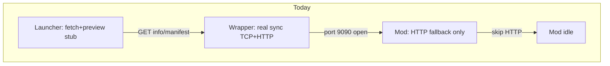
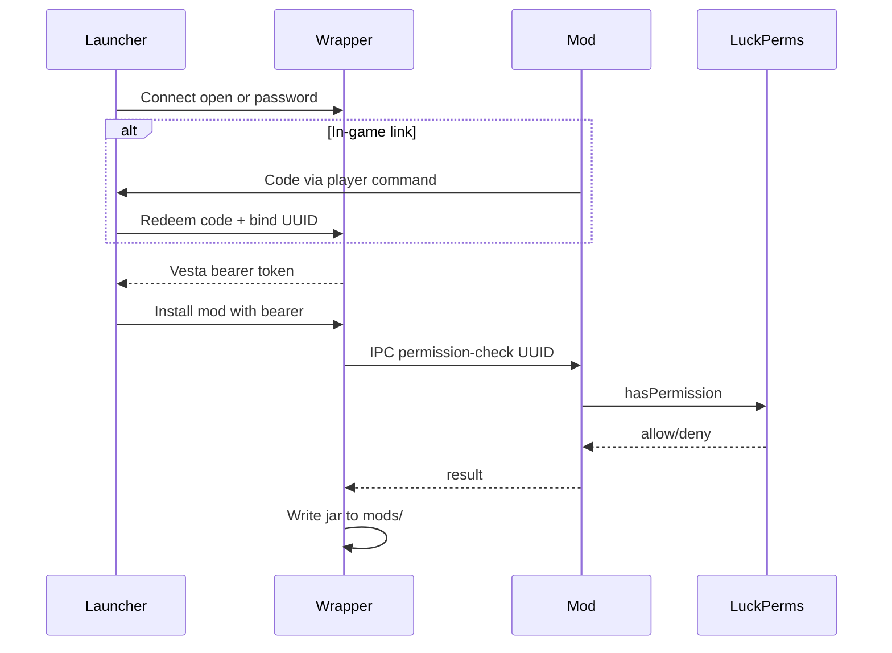

# Vesta Server Sync — Product Roadmap

Durable product and architecture decisions for Vesta sync (wrapper + mod/plugin + launcher).  
Protocol details remain in [`SERVER_SYNC_SPEC.md`](../SERVER_SYNC_SPEC.md). Build/publish details remain in [`PUBLISHING.md`](PUBLISHING.md).

**Status:** Design locked via product grilling (2026-07). Backend implementation phased below. **Launcher UI postponed** until architecture cleanup and backend are ready. Do **not** reset the launcher `server-import` branch for experiments — use it as-is.

---

## 1. Goals and non-goals

### Goals

- Players/operators enter a sync server address in the Vesta launcher and get the right files to join.
- **Wrapper-first** always-on sync sidecar (MC-agnostic).
- **Optional mod/plugin** for identity, in-game permissions, join control, and ephemeral hosts that do not run a 24/7 sidecar alone.
- Remote mod/config install from a linked launcher account, gated by security mode + (when available) in-game permissions.
- Near-complete **backend** capability; launcher UI ships incrementally after cleanup.
- Automated **tests gate every backend phase**.

### Non-goals (for now)

- Pterodactyl-class full panel (file browser, worlds, backups) as a v1 UI — list eventual APIs, implement UI later.
- Resetting or rewriting the launcher branch while architecture cleanup is in progress.
- Hot-loading arbitrary jars into a live JVM (write to disk while running; load on restart — normal Minecraft).

---

## 2. Current state vs aspirational



### Working today

| Area | Reality |
|------|---------|
| Wrapper | Scan `mods/`/`config/`, content-addressable store, multiplexed TCP+HTTP on `:9090`, sync-check, file serve |
| Core | Manifest builder, differ, sync-check, path sanitizer — unit tested |
| Mod | Tiered release lines (~12 JARs); HTTP fallback if wrapper absent; **idle when wrapper detected** |
| Launcher (`server-import`) | Connect → fetch info/manifest → display; **install stubbed** |

### Missing / flawed today

- Mod is a no-op when wrapper is up — no `/vesta link`, no permission bridge, no join validation.
- Auth, TLS, upload, push updates, version history: documented / deps present, not implemented.
- Manifest built once at startup; timestamps hardcoded.
- TCP session UUID not validated against message `session` field; effectively open with no warning.
- Dual stores (`vesta-files` vs `vesta-store`); mod metadata hardcoded.
- Launcher: no server entity, no instance↔server link, platform enum is Modrinth/CurseForge only.

### Aspirational

Hybrid auth, local control IPC, remote install, linked UUID + LuckPerms, first-class servers in launcher (post-cleanup), management APIs on backend, UI phased.

---

## 3. Wrapper vs mod — responsibilities and degrade rules

### Why both products

| Deploy | Use when |
|--------|----------|
| **Wrapper only** | Always-on sync host; bare functionality; password/token/open auth; disk writes for remote install |
| **Mod only** | Ephemeral / no sidecar; HTTP sync fallback; later identity + join hooks |
| **Both (ideal)** | Wrapper owns public sync + writes; mod owns in-game identity/perms via **loopback IPC** |

Operators may choose one. Prefer both for remote admin + RBAC.

### Responsibility matrix

| Concern | Wrapper only | Mod only | Both |
|---------|--------------|----------|------|
| Public sync API (read) | Primary | Fallback HTTP | Wrapper owns public port |
| Remote install/remove | Owns disk + rescan | Rare / N/A | Wrapper writes; mod for perms |
| Auth: open / password / token | Yes | Prefer same core if practical | Wrapper |
| `/vesta link`, LuckPerms/Vault | No | Yes | Mod answers IPC |
| Join enforcement | No | Yes | Mod |
| Process / console (eventual) | If wrapper manages process | Soft signals only | Wrapper |

### Degrade rules

1. If mod is **down** and action requires in-game permission → **deny** with clear error (`mod offline — permission check unavailable`), unless the action is allowed under wrapper-only auth for that security mode.
2. If wrapper is **down** and mod is up → mod may serve HTTP sync only; no public TCP multiplexing unless we later teach mod to own it.
3. **Open** security mode → allow unauthenticated sync (and only explicitly configured open management) with **loud warnings** in wrapper logs and launcher connect UI.

---

## 4. Security modes and identity

### Locked decisions

| Topic | Decision |
|-------|----------|
| Permission authority | **Hybrid**: in-game perms via mod when present; wrapper-only password / UUID bind / invite / **open + warning** when not |
| Identity key | Linked **Minecraft UUID**; Vesta issues its **own** bearer tokens after link |
| Microsoft sessions | **Never** use raw Microsoft/Minecraft session tokens as server auth over the wire |
| Linking | Multi-path (see below) |

### Security modes

| Mode | Trust established by | Warning |
|------|----------------------|---------|
| `open` | Anyone who can reach the port | **Required** — wrapper log + launcher UI |
| `password` / invite token | Shared secret in config | Soft warn if weak/shared |
| `linked` | Vesta bearer bound to UUID | — |
| `linked` + in-game perms | Bearer + IPC permission check | Deny if mod offline for perm-gated ops |

### Linking paths (all supported)

1. **Open** — no link (warn).
2. **Password / invite** — wrapper-only; first successful auth may bind claimed UUID.
3. **Launcher-initiated code** — code shown on console/admin; confirm in-game (mod) or by admin paste.
4. **In-game `/vesta link` (or `/auth`)** — player online → short-lived code → redeem in launcher (proves control of that UUID).

After successful link, launcher stores a **Vesta-issued bearer** (refresh/rotate as designed later). UUID is what LuckPerms and plugins already understand.



---

## 5. Control IPC (wrapper ↔ mod)

**Decision:** dedicated **loopback control channel** (not public `:9090`). Length-prefixed JSON or equivalent over `127.0.0.1` TCP (Unix socket later if useful). This is normal for sidecar ↔ in-process agent (similar spirit to language servers / local Docker API — not Tauri OS IPC).

### Responsibilities of the control channel

- Mutual **heartbeat** → both know if the peer is running (“linked and both up”).
- **Permission-check** (`uuid`, `permission` → allow / deny).
- **Link-code** issue / validate coordination.
- Optional: player-online hints, soft restart signals.

### Rules

- Public sync stays on multiplexed **9090**.
- Control port is **localhost-only**; never expose on `0.0.0.0`.
- Shared-file permission cache is **not** primary; optional secondary with explicit reload (`/vesta reload-perms`) if we add it later.
- Fake-peer contract tests required (see §12).

---

## 6. Remote install / remove

**Decision:** write straight into `mods/` (and configured paths) **while the server is running**. No staging/apply pipeline. Jars load on next restart — normal Minecraft behavior.

| Step | Owner |
|------|--------|
| AuthN / AuthZ | Wrapper (+ IPC perm check when required) |
| Download / accept upload | Wrapper |
| Write to disk | Wrapper |
| Rescan manifest / bump version | Wrapper (live rescan after write — required improvement vs today’s startup-only scan) |
| Restart | Operator (optional later: process control API) |

UI may later show “files changed since last restart”; **not required** for v1 backend.

---

## 7. Eventual management API surface (backend first)

UI can lag; backend should aim to cover these capabilities over phases.

| Area | Capabilities |
|------|----------------|
| Sync | info, manifest, versions/history, sync-check, file download, push-update notify |
| Content | remote install/remove mods & configs, rescan, path policy |
| Identity | security modes, link redeem, bearer issue/revoke, UUID bind |
| Permissions | IPC bridge to Vault/LuckPerms/native; permission node catalog (`vesta.*`) |
| Presence | control heartbeat, mod/wrapper status for launcher |
| Ops (later) | process start/stop/restart if wrapper owns process; console log stream; online players list |
| Deep ops (later still) | file browser, worlds, backups — out of early UI scope |

---

## 8. Postponed launcher work

**Do not implement until:** backend phases for auth + install are usable **and** launcher architecture cleanup is done. Keep using `server-import` for fetch/preview experiments only.

### Product model (locked)

- **Server** is a **first-class saved connection** (list, pin, reconnect).
- An **Instance can link to a Server** (same mental model as linking a modpack).
- Home stays **instance-primary**; Servers live in a section / filter; optional pinned server cards.
- Requires an **advanced home list refactor** (categories + filtering) — treat as a prerequisite, not a bolt-on.

### Phased UI (after cleanup)

1. Persist server entity; reconnect; install-from-server (finish stub).
2. Link instance ↔ server; update/sync pull using sync-check.
3. Account link UX (codes, password, open warning).
4. Remote install/remove UI (permission-aware).
5. Light ops: status, players, restart if API exists.
6. Deep ops only if product demand proves it.

### Constraints today (why postpone)

- Home renders `instancesStore()` only; pinning types are instance/resource/settings.
- DB has no server table; `SourcePlatform` is Modrinth|CurseForge.
- VersioningTab / repair assume platform modpacks.

---

## 9. Advanced ideas (backlog)

- User-scoped manifests (beta testers see different packs).
- Push `update_available` when rescan changes hashes.
- Manifest signing / TOFU TLS for public endpoints.
- Rate limiting, audit log of remote installs.
- LuckPerms REST as optional **alternate** perm backend when Vesta mod is absent but LP REST is configured (explicit opt-in; not default vs IPC).
- Platform modpack mode (Modrinth/CF pointer) from the sync spec.

---

## 10. Design flaws and risks (be critical)

| Risk | Why it matters | Mitigation |
|------|----------------|------------|
| Mod idle when wrapper up | Blocks auth story if we forget IPC | IPC is mandatory for hybrid; change “detect → skip everything” to “detect → skip HTTP only” |
| Open mode abuse | Sync/install exposed on LAN/WAN | Loud warn; default recommend password; document binding public host carefully |
| UUID bind without in-game proof | Spoofed UUID claims | Prefer `/vesta link` when mod present; password+admin for wrapper-only |
| Stale perms if we used files | Wrong allow/deny | Loopback IPC + fail closed when mod down |
| Live write + no rescan | Clients see old manifest | Rescan after every install/remove |
| Session not validated | Protocol holes | Validate bearer/session on mutating APIs |
| Dual file stores | Operator confusion | Unify on wrapper store when both present |
| “Full management UI” scope creep | Never ships | Backend hooks yes; UI phases; deep ops last |
| Launcher branch churn | Lost work / conflicts | No reset; postpone features; experiment on `server-import` |

---

## 11. Phased backend implementation order

Each phase **includes tests** (§12). Do not mark a phase done without them.

| Phase | Deliverable |
|-------|-------------|
| **0** | Baseline: keep core tests green; fix/document known stubs |
| **1** | Security modes in config; open warning; password; Vesta bearer issue/validate; session validation on mutating routes |
| **2** | Control IPC + heartbeat; mod “skip HTTP only”; permission adapter interface + fakes |
| **3** | Link codes (`/vesta link` + redeem); UUID bind storage |
| **4** | Remote install/remove + **live rescan**; unauthorized reject |
| **5** | Push notify + real version listing/history (as needed) |
| **6** | Process/console/player list hooks (if wrapper manages process) |
| **7** | TLS/TOFU, rate limits, audit (hardening) |

Launcher phases follow architecture cleanup and at least backend phases 1–4.

---

## 12. Testing strategy

Tests are **not optional**. Document conventions here; implement with each phase.

### Layers

| Layer | Where | What |
|-------|--------|------|
| Unit (`:core`) | `core/src/test` | Manifest diff, sync-check, PathSanitizer, FileStore, token hashing, pure permission decisions, IPC codec |
| Unit (`:wrapper`) | `wrapper/src/test` | Config security modes, auth handshake, open-mode warning, install/remove writes, rescan, session validation |
| IPC contract | Core/wrapper + fake peer | Heartbeat both-up / mod-down, perm allow/deny/unavailable, link-code redeem |
| HTTP/TCP integration | Ephemeral ports | Multiplexed 9090, auth matrix, file serve, sync-check (graduate ideas from `run.ps1`) |
| Mod permission adapter | Unit + fakes | Vault/LuckPerms/native — **no live Minecraft in CI** |
| Launcher (later) | Vitest + Tauri mocks | Extend `server-sync.test.ts`; server entity; install-from-server |

### Rules

- **Gate:** phase incomplete without tests for new public APIs and security modes (including open-mode warning).
- **Fixtures:** temp dirs for scan-root / writes; never mutate `demo-server` as a shared fixture.
- **CI:** `:core:test` always; `:wrapper:test` once present; adapter tests on JVM only.
- **Manual only:** full Fabric/Paper + live LuckPerms — scripted smoke, not a CI blocker until a harness exists.
- **Regression:** existing core tests (`ManifestDiffer`, `SyncCheckService`, etc.) stay green.

### Phase → test mapping

1. Auth modes → unit + HTTP 401/200 matrix (open / password / token).
2. IPC → fake-peer heartbeat + permission-check contract.
3. Remote install → write jar, rescan, unauthorized reject.
4. Link codes → redeem once, expire, UUID bind.
5. Process/console → mocked process controller tests.

---

## 13. Manual smoke (current branches)

Until backend phases land, use:

```powershell
# Server
cd V:\server
.\gradlew.bat :core:test :wrapper:installDist
# Run demo wrapper (see RUNNING.md)

# Launcher — keep server-import for experiments; do not reset
cd V:\launcher\vesta-launcher
npm run tauri dev
# Install Source → Server → localhost:9090 → preview only
```

Protocol smoke: [`run.ps1`](../run.ps1) (TCP `0x00` prefix when multiplexed).

---

## Related docs

- [`ARCHITECTURE.md`](ARCHITECTURE.md) — layout, tech, loaders
- [`PUBLISHING.md`](PUBLISHING.md) — wrapper vs tiered mod JARs
- [`../RUNNING.md`](../RUNNING.md) — run the wrapper
- [`../SERVER_SYNC_SPEC.md`](../SERVER_SYNC_SPEC.md) — wire protocol (superset of implementation)
