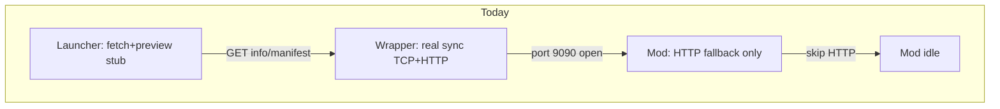
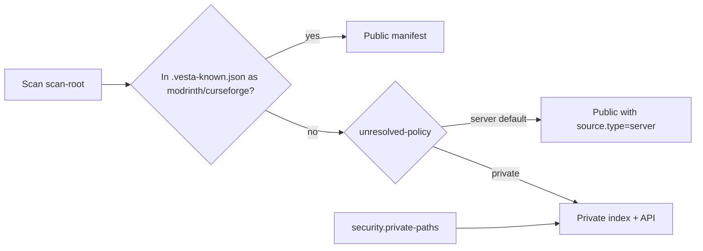
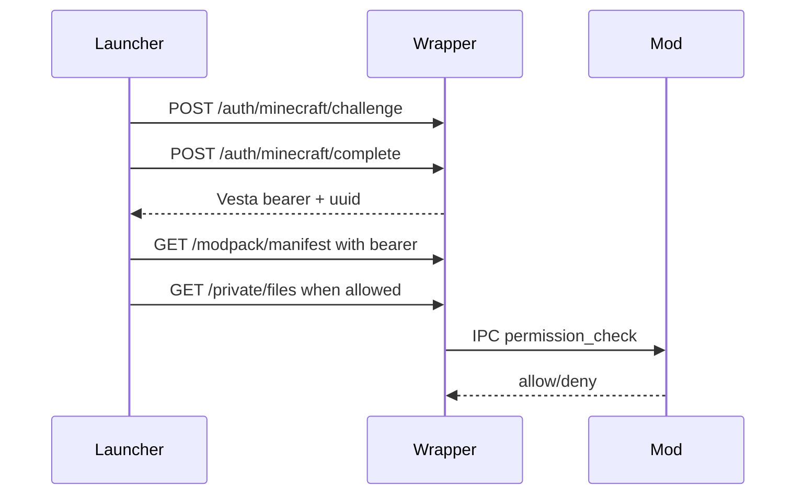
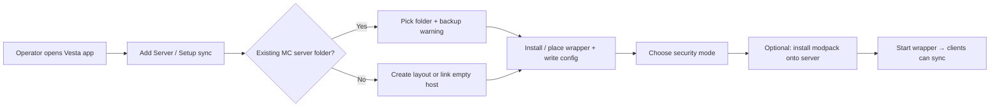

# Vesta Server Sync — Product Roadmap

Durable product and architecture decisions for Vesta sync (wrapper + mod/plugin + launcher).  
Protocol details remain in [`SERVER_SYNC_SPEC.md`](../SERVER_SYNC_SPEC.md). Build/publish details remain in [`PUBLISHING.md`](PUBLISHING.md).

**Status:** Design locked via product grilling (2026-07). Backend implementation phased below. **Launcher UI postponed** until architecture cleanup and backend are ready. Do **not** reset the launcher `server-import` branch for experiments — use it as-is.

---

## 1. Goals and non-goals

### Goals

- Players/operators enter a sync server address in the Vesta launcher and get the right files to join.
- **Wrapper-first** always-on sync sidecar (MC-agnostic).
- **Optional mod/plugin** for identity, in-game permissions, join control, and ephemeral hosts that do not run a 24/7 sidecar alone.
- Remote mod/config install from a linked launcher account, gated by security mode + (when available) in-game permissions.
- Near-complete **backend** capability; launcher UI ships incrementally after cleanup.
- Automated **tests gate every backend phase**.

### Non-goals (for now)

- Pterodactyl-class full panel (file browser, worlds, backups) as a v1 UI — list eventual APIs, implement UI later.
- Resetting or rewriting the launcher branch while architecture cleanup is in progress.
- Hot-loading arbitrary jars into a live JVM (write to disk while running; load on restart — normal Minecraft).

---

## 2. Current state vs aspirational



### Working today

| Area | Reality |
|------|---------|
| Wrapper | Scan `mods/`/`config/`, content-addressable store, multiplexed TCP+HTTP on `:9090`, sync-check, file serve |
| Core | Manifest builder, differ, sync-check, path sanitizer — unit tested |
| Mod | Tiered release lines (~12 JARs); HTTP fallback if wrapper absent; **idle when wrapper detected** |
| Launcher (`server-import`) | Connect → fetch info/manifest → display; **install stubbed** |

### Missing / flawed today

- Launcher install-from-server still partial (resolve + private list APIs exist; full instance apply UI pending).
- Minecraft session-challenge auth and capability levels implemented on wrapper; launcher auth commands added.
- Known vs private split implemented; dual blob cache removed for wrapper scans.
- **Installer scripts** added (`install-wrapper.ps1` / `.sh`); app wizard still pending.

### Aspirational

Hybrid auth with layered capabilities, MR/CF-known public modpack + private unknown tree, first-class servers in launcher (post-cleanup), management APIs on backend, UI phased.

---

## 3. Wrapper vs mod — responsibilities and degrade rules

### Why both products

| Deploy | Use when |
|--------|----------|
| **Wrapper only** | Always-on sync host; bare functionality; password/token/open auth; disk writes for remote install |
| **Mod only** | Ephemeral / no sidecar; HTTP sync fallback; later identity + join hooks |
| **Both (ideal)** | Wrapper owns public sync + writes; mod owns in-game identity/perms via **loopback IPC** |

Operators may choose one. Prefer both for remote admin + RBAC.

### Responsibility matrix

| Concern | Wrapper only | Mod only | Both |
|---------|--------------|----------|------|
| Public sync API (read) | Primary | Fallback HTTP | Wrapper owns public port |
| Remote install/remove | Owns disk + rescan | Rare / N/A | Wrapper writes; mod for perms |
| Auth: open / password / token | Yes | Prefer same core if practical | Wrapper |
| `/vesta link`, LuckPerms/Vault | No | Yes | Mod answers IPC |
| Join enforcement | No | Yes | Mod |
| Process / console (eventual) | If wrapper manages process | Soft signals only | Wrapper |

### Degrade rules

1. If mod is **down** and action requires in-game permission → **deny** with clear error (`mod offline — permission check unavailable`), unless the action is allowed under wrapper-only auth for that security mode.
2. If wrapper is **down** and mod is up → mod may serve HTTP sync only; no public TCP multiplexing unless we later teach mod to own it.
3. **Open** security mode → allow unauthenticated sync (and only explicitly configured open management) with **loud warnings** in wrapper logs and launcher connect UI.

---

## 4. Security modes, identity, and content split

### Locked decisions

| Topic | Decision |
|-------|----------|
| Permission authority | **Hybrid**: in-game perms via mod when present; configurable capability matrix for all non-open modes |
| Identity key | Linked **Minecraft UUID**; Vesta issues its **own** bearer tokens after link |
| Microsoft sessions | **Session challenge only** (`POST /api/v1/auth/minecraft/challenge` + complete via Mojang {@code join}/{@code hasJoined}); Minecraft access tokens never pass through Vesta; ongoing API uses Vesta bearer only |
| Linking | Multi-path: MSA bootstrap, password, `/vesta link`, launcher link redeem |
| Public modpack | **Known** files (MR/CF via `.vesta-known.json` sidecar) on public manifest; clients prefer platform CDN |
| Private resources | **Unknown** files + configured `security.private-paths`; served from live disk via authenticated `/api/v1/private/files` |
| Blob cache | **No** `vesta-files` mirror on wrapper scan — single copy under `mods/`/`config/` |

### Content model (known vs private)



Classification is enriched by the **launcher** when seeding (SHA1 → Modrinth, CF fingerprint → CurseForge). Wrapper reads `.vesta-known.json` on rescan.

### Security modes

| Mode | Public modpack | Private resources | Manage |
|------|----------------|-------------------|--------|
| `open` | Anyone | Denied (default) | Denied (default) |
| `password` | Auth bearer | Linked UUID (+ optional whitelist) | Password and/or in-game perm / admin list |
| `linked` | Auth bearer | Linked UUID | In-game perm / admin list |
| `whitelist` | Linked + whitelist | Linked + whitelist | Elevated (perm / admin / password per config) |

### Access levels (`[security.levels]`)

Levels 0–4 grant named capabilities (`stats.read`, `pack.fetch`, `console.read`,
`files.read`, `console.execute`, `files.write`, `settings.manage`, `content.manage`).
Effective level is the max of identity baselines, Minecraft OP level from `ops.json`
(1:1), `[security.people]`, and `[security.perm-nodes]`. See bundled
`wrapper-config.toml` for the full commented defaults. Legacy
`[security.capabilities]` tables are still accepted and mapped into levels.

### Linking paths

1. **Minecraft session challenge** — launcher joins a short-lived Mojang serverId; wrapper verifies via {@code hasJoined} and issues a linked bearer.
2. **Password** — shared secret → operator bearer (link UUID separately via session challenge or `/vesta link`).
3. **In-game `/vesta link`** — code → redeem in launcher.
4. **Open** — warn only; no private access by default.



---

## 5. Control IPC (wrapper ↔ mod)

**Decision:** dedicated **loopback control channel** (not public `:9090`). Length-prefixed JSON or equivalent over `127.0.0.1` TCP (Unix socket later if useful). This is normal for sidecar ↔ in-process agent (similar spirit to language servers / local Docker API — not Tauri OS IPC).

### Responsibilities of the control channel

- Mutual **heartbeat** → both know if the peer is running (“linked and both up”).
- **Permission-check** (`uuid`, `permission` → allow / deny).
- **Link-code** issue / validate coordination.
- Optional: player-online hints, soft restart signals.

### Rules

- Public sync stays on multiplexed **9090**.
- Control port is **localhost-only**; never expose on `0.0.0.0`.
- Shared-file permission cache is **not** primary; optional secondary with explicit reload (`/vesta reload-perms`) if we add it later.
- Fake-peer contract tests required (see §12).

---

## 6. Remote install / remove

**Decision:** write straight into `mods/` (and configured paths) **while the server is running**. No staging/apply pipeline. Jars load on next restart — normal Minecraft behavior.

| Step | Owner |
|------|--------|
| AuthN / AuthZ | Wrapper (+ IPC perm check when required) |
| Download / accept upload | Wrapper |
| Write to disk | Wrapper |
| Rescan manifest / bump version | Wrapper (live rescan after write — required improvement vs today’s startup-only scan) |
| Restart | Operator (optional later: process control API) |

UI may later show “files changed since last restart”; **not required** for v1 backend.

---

## 7. Eventual management API surface (backend first)

UI can lag; backend should aim to cover these capabilities over phases.

| Area | Capabilities |
|------|----------------|
| Sync | info, manifest, versions/history, sync-check, file download, push-update notify |
| Content | remote install/remove mods & configs, rescan, path policy |
| Identity | security modes, link redeem, bearer issue/revoke, UUID bind |
| Permissions | IPC bridge to Vault/LuckPerms/native; permission node catalog (`vesta.*`) |
| Presence | control heartbeat, mod/wrapper status for launcher |
| Ops (later) | process start/stop/restart if wrapper owns process; console log stream; online players list |
| Deep ops (later still) | file browser, worlds, backups — out of early UI scope |

---

## 8. Postponed launcher work

**Do not implement until:** backend phases for auth + install are usable **and** launcher architecture cleanup is done. Keep using `server-import` for fetch/preview experiments only.

### Product model (locked)

- **Server** is a **first-class saved connection** (list, pin, reconnect).
- An **Instance can link to a Server** (same mental model as linking a modpack).
- Home stays **instance-primary**; Servers live in a section / filter; optional pinned server cards.
- Requires an **advanced home list refactor** (categories + filtering) — treat as a prerequisite, not a bolt-on.

### Phased UI (after cleanup)

1. Persist server entity; reconnect; install-from-server (finish stub).
2. Link instance ↔ server; update/sync pull using sync-check.
3. Account link UX (codes, password, open warning).
4. Remote install/remove UI (permission-aware).
5. Light ops: status, players, restart if API exists.
6. Deep ops only if product demand proves it.

### Constraints today (why postpone)

- Home renders `instancesStore()` only; pinning types are instance/resource/settings.
- DB has no server table; `SourcePlatform` is Modrinth|CurseForge.
- VersioningTab / repair assume platform modpacks.

---

## 8b. Operator setup, installers, and “seed the server” UX

**Status:** Product direction captured here; **not implemented** yet. Backend phases 1–5 exist; this is the missing **day-0 install** story.

### Goals

- A **good first-run installer** for the wrapper (Windows + Linux scripts at minimum; maybe a small bootstrap JAR/`installDist` zip).
- **Existing Minecraft servers** are first-class: point at an existing root (`mods/`, `config/`, worlds untouched by default), do not assume greenfield.
- **Backup warning** before any write that could affect the live tree (installer, first remote install, bulk modpack apply).
- Prefer **Vesta app–guided setup** for most operators; keep a scripted/headless path for pros and CI.

### Proposed flow (app-first, script fallback)



| Step | App (preferred) | Script / CLI |
|------|-----------------|--------------|
| Discover / pick server root | Folder picker | `--server-root` |
| Backup warning | Modal: “Back up `mods/` / `config/` (and worlds if touching them) before continuing” — must acknowledge | Printed WARNING + `--i-have-a-backup` flag |
| Place wrapper | Download/copy `wrapper` dist into server or sidecar dir | `install-wrapper.ps1` / `.sh` |
| Write `wrapper-config.toml` | Form: name, MC version, security mode, scan paths | Template + flags |
| Optional Vesta **mod/plugin** | Offer install into `mods/` / `plugins/` for IPC + `/vesta link` | Same, optional |
| **Install a modpack onto the server** | UI: pick Modrinth/CF/local pack → write jars/configs into server tree via wrapper APIs or local apply | Optional; script can call same APIs |
| Start | “Start sync” / service helper | `wrapper.bat` / systemd unit later |

### Existing servers — rules

1. **Non-destructive by default:** installer only adds wrapper binary, config, and start script. It does **not** delete worlds or wipe `mods/` unless the operator explicitly chooses a modpack apply.
2. **Scan what is already there:** first run builds a manifest from existing `mods/` + `config/` so clients can join the *current* pack.
3. **Modpack apply is a separate, louder action:** “Replace / merge server content with this pack” with backup ack + diff preview when UI exists.
4. **Sidecar vs in-tree:** support both “wrapper lives inside the server folder” and “wrapper lives beside it with `scan-root` pointing at the server.”

### Install script / bootstrap deliverables (new backend/ops phase)

| Artifact | Purpose |
|----------|---------|
| `install-wrapper.ps1` / `install-wrapper.sh` | Detect/create layout, copy dist, write config, **backup warning** — **implemented** |
| Optional `vesta-wrapper` zip from CI | Self-contained `installDist` + scripts |
| App “Setup Server Sync” wizard | Same steps with UI; may shell out to installer or embed logic |
| Docs in RUNNING / PUBLISHING | One-pager: existing server vs new; open vs password |

Add as **Phase 8 (ops/setup)** after hardening, or pull earlier if day-0 friction blocks testing — prefer **Phase 5.5 / parallel** once remote install APIs are stable so the app can call them during “install modpack onto server.”

### App: install a modpack *for the server*

Distinct from “client instance installs from server”:

| Direction | Meaning |
|-----------|---------|
| **Client ← Server** (sync) | Launcher pulls files the wrapper already serves |
| **Server ← Pack** (seed / manage) | Operator uses the app to push a Modrinth/CF/local modpack *onto* the Minecraft server (remote upload / apply), then clients sync that |

Seed UI depends on remote install APIs (already sketched) + platform download in the launcher. Gate behind auth and backup ack.

### Open decisions (lock in grilling)

1. **Must setup go through the app?** Recommendation: **app-preferred, not exclusive** — scripts remain for headless/dedicated hosts; app is the happy path and can refuse advanced ops until a server entity exists.
2. **Where does the wrapper binary live by default?** In-server vs `%LOCALAPPDATA%`/sidecar with `scan-root`.
3. **Service install** (Windows service / systemd) in v1 or later?

---

## 8c. Storage model (post split)

| Path | Role |
|------|------|
| `mods/`, `config/` (scan-root) | **Live** server tree — single on-disk copy |
| `.vesta-known.json` | Sidecar mapping paths → MR/CF `FileSource` (launcher-written) |
| `security.private-paths` | Extra trees indexed as private-only |
| ~~`vesta-files/`~~ | **Removed** from wrapper scan path — no duplicate blob cache |

Public downloads: known files use platform CDN URLs in manifest; `source.type=server` files use `GET /api/v1/files/{sha256}` served from live path (requires `pack.fetch` bearer). `GET /api/v1/private/files` and `GET /api/v1/private/files/{path}` are **deprecated** (`410 Gone`); pack content is unified in the gated manifest.

Mod-only HTTP fallback may still use a local store until aligned — wrapper is canonical.

---

## 9. Advanced ideas (backlog)

- User-scoped manifests (beta testers see different packs).
- Push `update_available` when rescan changes hashes.
- Manifest signing / TOFU TLS for public endpoints.
- Rate limiting, audit log of remote installs.
- LuckPerms REST as optional **alternate** perm backend when Vesta mod is absent but LP REST is configured (explicit opt-in; not default vs IPC).
- Platform modpack mode (Modrinth/CF pointer) from the sync spec.

---

## 10. Design flaws and risks (be critical)

| Risk | Why it matters | Mitigation |
|------|----------------|------------|
| Mod idle when wrapper up | Blocks auth story if we forget IPC | IPC is mandatory for hybrid; change “detect → skip everything” to “detect → skip HTTP only” |
| Open mode abuse | Sync/install exposed on LAN/WAN | Loud warn; default recommend password; document binding public host carefully |
| UUID bind without in-game proof | Spoofed UUID claims | Prefer `/vesta link` when mod present; password+admin for wrapper-only |
| Stale perms if we used files | Wrong allow/deny | Loopback IPC + fail closed when mod down |
| Live write + no rescan | Clients see old manifest | Rescan after every install/remove |
| Session not validated | Protocol holes | Validate bearer/session on mutating APIs |
| Dual file stores | Operator confusion | Removed wrapper blob cache; single live tree + optional mod fallback cleanup |
| “Full management UI” scope creep | Never ships | Backend hooks yes; UI phases; deep ops last |
| Launcher branch churn | Lost work / conflicts | No reset; postpone features; experiment on `server-import` |
| No day-0 installer | Operators can’t adopt wrapper | Phase 5.5 scripts + app-first setup (§8b); backup warning required |
| Seed pack wipes existing server | Data loss | Existing-server mode; backup ack; merge vs replace explicit |

---

## 11. Phased backend implementation order

Each phase **includes tests** (§12). Do not mark a phase done without them.

| Phase | Deliverable | Status |
|-------|-------------|--------|
| **0** | Baseline: keep core tests green; fix/document known stubs | done |
| **1** | Security modes in config; open warning; password; Vesta bearer issue/validate; session validation on mutating routes | done |
| **2** | Control IPC + heartbeat; mod “skip HTTP only”; permission adapter interface + fakes | done |
| **3** | Link codes (`/vesta link` + redeem); UUID bind storage | done |
| **4** | Remote install/remove + **live rescan**; unauthorized reject | done |
| **5** | Push notify + real version listing/history (as needed) | partial (push notify + payload parity; version history deferred) |
| **A** | **Known/private split**: `.vesta-known.json`, unresolved policy, private API, no wrapper blob duplicate | done |
| **B** | **Minecraft session-challenge auth**, capability engine / access levels, layered gates on all non-open modes | done |
| **C** | Whitelist + admin UUID list + OP/LP bridge + tests | done |
| **D** | Launcher: auth commands, token store, private fetch, manifest resolve | deferred (launcher UI postponed) |
| **E** | `install-wrapper.ps1` / `.sh` + one-liner multi-instance installer (`--instance`, registry, backup, verify) | done |
| **6** | Process/console/player list hooks (if wrapper manages process) | **console done**; **players REST done** (realtime `players_changed` deferred); file browser streaming R/W done |
| **7** | TLS/TOFU, rate limits, audit (hardening) | **rate limits configurable + 429**; TLS fingerprint on status/descriptor; full TOFU pinning deferred |
| **8** | App: seed server from modpack + setup wizard UX | deferred |

**Ops additions (2026-07):** loopback-only `/devtools` (debug banner, not a production panel); `vesta-wrapperctl` multi-instance CLI; end-to-end `scripts/smoke-wrapper.ps1` / `.sh`.

Launcher phases follow architecture cleanup and at least backend phases 1–4; **setup wizard / seed-server UI** after 5.5 APIs + home server entity.

---

## 12. Testing strategy

Tests are **not optional**. Document conventions here; implement with each phase.

### Layers

| Layer | Where | What |
|-------|--------|------|
| Unit (`:core`) | `core/src/test` | Manifest diff, sync-check, PathSanitizer, FileStore, token hashing, pure permission decisions, IPC codec |
| Unit (`:wrapper`) | `wrapper/src/test` | Config security modes, auth handshake, open-mode warning, install/remove writes, rescan, session validation |
| IPC contract | Core/wrapper + fake peer | Heartbeat both-up / mod-down, perm allow/deny/unavailable, link-code redeem |
| HTTP/TCP integration | Ephemeral ports | Multiplexed 9090, auth matrix, file serve, sync-check (graduate ideas from `run.ps1`) |
| Mod permission adapter | Unit + fakes | Vault/LuckPerms/native — **no live Minecraft in CI** |
| Launcher (later) | Vitest + Tauri mocks | Extend `server-sync.test.ts`; server entity; install-from-server |

### Rules

- **Gate:** phase incomplete without tests for new public APIs and security modes (including open-mode warning).
- **Fixtures:** temp dirs for scan-root / writes; never mutate `demo-server` as a shared fixture.
- **CI:** `:core:test` always; `:wrapper:test` once present; adapter tests on JVM only.
- **Manual only:** full Fabric/Paper + live LuckPerms — scripted smoke, not a CI blocker until a harness exists.
- **Regression:** existing core tests (`ManifestDiffer`, `SyncCheckService`, etc.) stay green.

### Phase → test mapping

1. Auth modes → unit + HTTP 401/200 matrix (open / password / token).
2. IPC → fake-peer heartbeat + permission-check contract.
3. Remote install → write jar, rescan, unauthorized reject.
4. Link codes → redeem once, expire, UUID bind.
5. Process/console → mocked process controller tests.

---

## 13. Manual smoke (current branches)

Primary wrapper smoke (console + fs + players + descriptor):

```powershell
cd V:\server-connections-mvp
.\gradlew.bat :core:test :wrapper:test :wrapper:installDist
.\scripts\smoke-wrapper.ps1
```

Until launcher phases land, use:

```powershell
# Launcher — keep server-import for experiments; do not reset
cd V:\launcher\vesta-launcher
npm run tauri dev
# Install Source → Server → localhost:9090 → preview only
```

Protocol smoke: [`run.ps1`](../run.ps1) (TCP `0x00` prefix when multiplexed).

CI keeps `:core:test` + `:wrapper:test`. Full `smoke-wrapper` (Paper start) is manual / operator — not a CI gate.

---

## Related docs

- [`ARCHITECTURE.md`](ARCHITECTURE.md) — layout, tech, loaders
- [`PUBLISHING.md`](PUBLISHING.md) — wrapper vs tiered mod JARs
- [`../RUNNING.md`](../RUNNING.md) — run the wrapper
- [`../SERVER_SYNC_SPEC.md`](../SERVER_SYNC_SPEC.md) — wire protocol (superset of implementation)
